<picture>
  <source
    media="(prefers-color-scheme: dark)"
    srcset="https://raw.githubusercontent.com/raj-kumar2310/raj-kumar2310/main/dark.svg">

  <source
    media="(prefers-color-scheme: light)"
    srcset="https://raw.githubusercontent.com/raj-kumar2310/raj-kumar2310/main/light.svg">

  
</picture>

